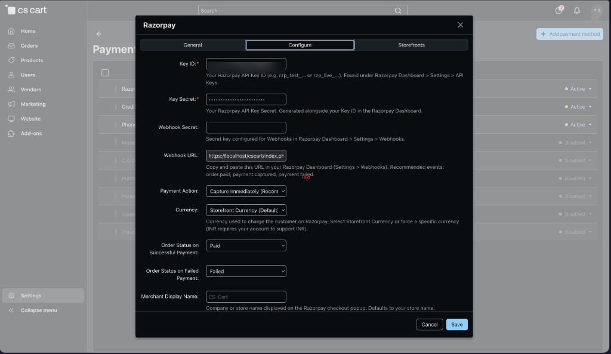

# Installation and Setup Guide

This guide walks you through the step-by-step process of installing, configuring, testing, and deploying the **Razorpay Payment Gateway** add-on for **CS-Cart** and **CS-Cart Multi-Vendor**.

---

## Table of Contents

1. [Prerequisites & System Requirements](#1-prerequisites--system-requirements)
2. [Obtaining Razorpay API Credentials](#2-obtaining-razorpay-api-credentials)
3. [Installation Methods](#3-installation-methods)
   - [Method A: Direct Copy / Git Clone (Recommended for Developers)](#method-a-direct-copy--git-clone-recommended-for-developers)
   - [Method B: ZIP Package Upload via CS-Cart Admin](#method-b-zip-package-upload-via-cs-cart-admin)
4. [Add-on Activation](#4-add-on-activation)
5. [Database Schema Verification](#5-database-schema-verification)
6. [Configuring the Payment Method in CS-Cart](#6-configuring-the-payment-method-in-cs-cart)
7. [Configuring Webhooks in Razorpay Dashboard](#7-configuring-webhooks-in-razorpay-dashboard)
8. [End-to-End Testing Guide](#8-end-to-end-testing-guide)
9. [Going Live Checklist](#9-going-live-checklist)
10. [Uninstallation & Teardown](#10-uninstallation--teardown)

---

## 1. Prerequisites & System Requirements

Before proceeding, ensure your server environment meets the following specifications:

| Requirement | Supported Versions | Notes |
| :--- | :--- | :--- |
| **CS-Cart Platform** | 4.12.x to 4.21.x | Standard, Ultimate, Multi-Vendor, and Multi-Vendor Plus/Ultimate |
| **PHP Version** | 7.4, 8.0, 8.1, 8.2 | Standard PHP installation |
| **PHP Extensions** | `curl`, `json`, `hash`, `openssl`, `mbstring` | Required for REST API calls & HMAC-SHA256 signature verification |
| **Database** | MySQL 5.7+ or MariaDB 10.3+ | InnoDB engine support |
| **SSL / HTTPS** | TLS 1.2+ required | Razorpay checkout and webhooks require HTTPS in production |

---

## 2. Obtaining Razorpay API Credentials

1. Log in to the [Razorpay Dashboard](https://dashboard.razorpay.com).
2. Toggle to **Test Mode** (in the top navigation bar or left sidebar) while setting up and testing.
3. In the left navigation, go to **Settings > API Keys**.
4. Click **Generate Test Key** (or **Regenerate Key** if you previously had keys).
5. A modal will display:
   - **Key ID** (format: `rzp_test_...` in Test mode, `rzp_live_...` in Live mode)
   - **Key Secret** (a 24+ character alpha-numeric string)
6. **Copy and save both values securely**. The Key Secret will only be displayed once!

---

## 3. Installation Methods

### Method A: Direct Copy / Git Clone (Recommended for Developers)

If you have filesystem access (SSH, SFTP, or local development like XAMPP):

1. Clone or copy the repository contents into your CS-Cart installation directory:

```bash
# Assuming CS-Cart is installed at /Applications/XAMPP/xamppfiles/htdocs/cscart
# and this repository is cloned at /Applications/XAMPP/xamppfiles/htdocs/git/cscart/razorpay

SOURCE="/Applications/XAMPP/xamppfiles/htdocs/git/cscart/razorpay"
TARGET="/Applications/XAMPP/xamppfiles/htdocs/cscart"

# Copy PHP backend and payment script
cp -R "$SOURCE/app/addons/razorpay" "$TARGET/app/addons/"

# Copy administration templates
cp -R "$SOURCE/design/backend/templates/addons/razorpay" "$TARGET/design/backend/templates/addons/"

# Copy storefront templates to active and repository theme paths
cp -R "$SOURCE/design/themes/responsive/templates/addons/razorpay" "$TARGET/design/themes/responsive/templates/addons/"
cp -R "$SOURCE/var/themes_repository/responsive/templates/addons/razorpay" "$TARGET/var/themes_repository/responsive/templates/addons/"

# Copy language dictionary
cp -R "$SOURCE/var/langs/en/addons/razorpay.po" "$TARGET/var/langs/en/addons/"
```

2. Clear CS-Cart cache from the command line:

```bash
cd /Applications/XAMPP/xamppfiles/htdocs/cscart
php -r "define('AREA', 'A'); define('BOOTSTRAP', ''); require 'init.php'; fn_clear_cache();"
```

---

### Method B: ZIP Package Upload via CS-Cart Admin

1. Prepare a distribution ZIP archive containing the exact folder structure:
   ```
   razorpay.zip
   ├── app/
   ├── design/
   └── var/
   ```
2. Log in to the CS-Cart Administration panel.
3. Go to **Add-ons > Manage add-ons**.
4. Click the gear (**⚙**) button in the top right corner and select **Manual installation**.
5. In the modal, select **Local** and upload `razorpay.zip`.
6. Click **Upload & install**.

---

## 4. Add-on Activation

1. In the CS-Cart Admin panel, go to **Add-ons > Manage add-ons**.
2. Search for **Razorpay Payments** in the list.
3. If not already active, click **Install** (or set the status selector to **Active**).
4. CS-Cart automatically executes `database/install.sql`, creating the required database tables and registering the `Razorpay` payment processor.

---

## 5. Database Schema Verification

When installed, `install.sql` automatically creates two dedicated tables and registers the processor in `?:payment_processors`:

```sql
-- 1. Check processor registration
SELECT processor_id, processor, processor_script, addon 
FROM cscart_payment_processors 
WHERE processor_script = 'razorpay.php';

-- 2. Check transaction audit table
SHOW TABLES LIKE '%razorpay_transactions%';

-- 3. Check webhook audit log table
SHOW TABLES LIKE '%razorpay_webhook_logs%';
```

---

## 6. Configuring the Payment Method in CS-Cart

1. In CS-Cart Admin, go to **Administration > Payment methods**.
2. Click the **+** (Add payment method) button in the upper right.
3. Fill in the **General** tab:
   - **Name**: `Razorpay (Cards, UPI, NetBanking, Wallets)`
   - **Processor**: Select **Razorpay** from the dropdown list.
   - **Template**: Will automatically select `views/orders/components/payments/cc_outside.tpl` or the processor default.
   - **User groups**: Check **All** (or restrict to desired user groups).
   - **Status**: Set to **Active**.
4. Click the **Configure** tab to configure the processor parameters:

<p align="center">
  
</p>

   - **Key ID**: Enter your Razorpay API Key ID (e.g. `rzp_test_...`).
   - **Key Secret**: Enter your Razorpay API Key Secret.
   - **Webhook Secret**: Enter a secure random string (e.g. `whsec_mysecretkey123`). You will enter the exact same string in your Razorpay Dashboard.
   - **Webhook URL**: Note down the automatically generated URL (e.g. `https://yourdomain.com/index.php?dispatch=payment_notification.notify&payment=razorpay`).
   - **Payment Action**: 
     - Choose **Capture Immediately** to capture payments automatically when authorized (Recommended for physical and digital goods).
     - Choose **Authorize Only** if you verify inventory manually and capture later.
   - **Currency**: 
     - **Storefront Currency**: Charges in whichever secondary currency the customer selected.
     - **INR (Indian Rupee)**: Automatically converts order totals to INR.
   - **Order Status on Successful Payment**: Select **Processed** (`P`) or **Complete** (`C`).
   - **Order Status on Failed Payment**: Select **Failed** (`F`).
   - **Merchant Display Name**: (Optional) Enter your company brand name (defaults to store company name).
   - **Modal Theme Color (HEX)**: (Optional) Enter a hex color code (e.g. `#3399cc` or `#0c2340`) to match your store branding.
5. Click **Create** (or **Save**).

---

## 7. Configuring Webhooks in Razorpay Dashboard

Webhooks guarantee that your orders are updated even if a customer loses internet connection or closes their browser before returning to the store.

1. Log in to the [Razorpay Dashboard](https://dashboard.razorpay.com).
2. Go to **Settings > Webhooks**.
3. Click **+ Add New Webhook**.
4. In the configuration dialog:
   - **Webhook URL**: Paste the Webhook URL from the CS-Cart configuration tab:
     ```
     https://your-domain.com/index.php?dispatch=payment_notification.notify&payment=razorpay
     ```
     *(Note: Must be a publicly accessible HTTPS URL. For local testing, use ngrok: `https://xxxx.ngrok-free.app/index.php?dispatch=payment_notification.notify&payment=razorpay`).*
   - **Secret**: Paste the exact **Webhook Secret** configured in CS-Cart.
   - **Alert Email**: Your operational support email.
   - **Active Events**: Select the following recommended events:
     - `order.paid`
     - `payment.authorized`
     - `payment.captured`
     - `payment.failed`
5. Click **Create Webhook**.

---

## 8. End-to-End Testing Guide

Razorpay provides a sandbox environment with test payment credentials:

### Test Payment Instruments

| Method | Test Details | Expected Result |
| :--- | :--- | :--- |
| **Card (Success)** | Number: `4111 1111 1111 1111`<br>Expiry: Any future date (e.g. `12/30`)<br>CVV: `123`<br>OTP: Any 6 digits (e.g. `123456`) | Payment Successful -> Order status changes to **Processed**. |
| **Card (Declined)** | Number: `4000 0000 0000 0002`<br>Expiry: Any future date<br>CVV: `123` | Payment Declined -> Order status changes to **Failed**. |
| **UPI** | VPA: `success@razorpay` | Instant authorization without OTP. |
| **UPI (Failure)** | VPA: `failure@razorpay` | Simulates UPI payment failure. |
| **NetBanking** | Select any bank in the test modal and click **Success** | Simulated bank portal authorization. |

### Verification Steps

1. Go to your storefront and add a product to the cart.
2. Proceed to **Checkout**.
3. Select the **Razorpay** payment method and click **Place order**.
4. The storefront will display the Razorpay checkout screen with a loader and automatically launch the Razorpay popup.
5. Enter test card `4111 1111 1111 1111`, submit, and enter OTP `123456`.
6. Razorpay will authorize the payment. The popup closes, and the browser submits the signature callback.
7. Verify that you are redirected to the **Order Confirmation** page.
8. In CS-Cart Admin (**Orders > View orders**), verify:
   - Order Status is **Processed** (`P`).
   - Payment info shows:
     - Transaction ID (`pay_...`)
     - Razorpay Order ID (`order_...`)
     - Method (`card`, `upi`, `netbanking`, etc.)
     - Card / bank details (network, last 4 digits).

---

## 9. Going Live Checklist

When ready to accept real customer payments:

- [ ] Complete Razorpay business KYC and activate your account for Live Mode.
- [ ] In Razorpay Dashboard, toggle the switch from **Test Mode** to **Live Mode**.
- [ ] Go to **Settings > API Keys** in Live Mode and generate **Live Key ID** (`rzp_live_...`) and **Live Key Secret**.
- [ ] In CS-Cart Admin (**Administration > Payment methods > Razorpay > Configure**):
  - Replace Test Key ID with **Live Key ID**.
  - Replace Test Key Secret with **Live Key Secret**.
  - Update Webhook Secret with your Live Webhook Secret.
- [ ] In Razorpay Dashboard (Live Mode), add your Live Webhook endpoint under **Settings > Webhooks**.
- [ ] Perform a real test transaction with a small amount (e.g. ₹10) to verify end-to-end settlement.

---

## 10. Uninstallation & Teardown

If you ever need to uninstall the add-on:

1. In CS-Cart Admin, go to **Add-ons > Manage add-ons**.
2. Find **Razorpay Payments** and click **Uninstall**.
3. CS-Cart automatically executes `database/uninstall.sql`:
   - Safely removes `?:razorpay_transactions`.
   - Safely removes `?:razorpay_webhook_logs`.
   - Removes the `Razorpay` payment processor registration from `?:payment_processors`.
4. Delete the add-on files from the filesystem if you wish to remove the source code completely.
