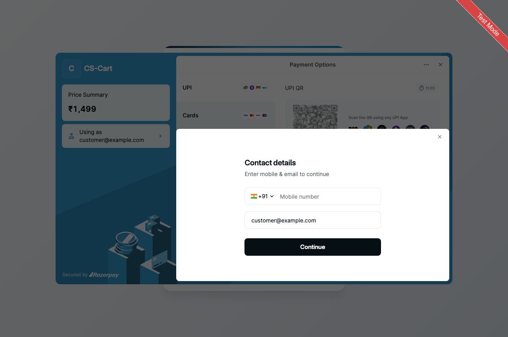
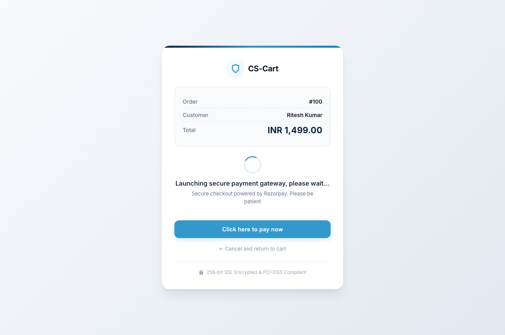
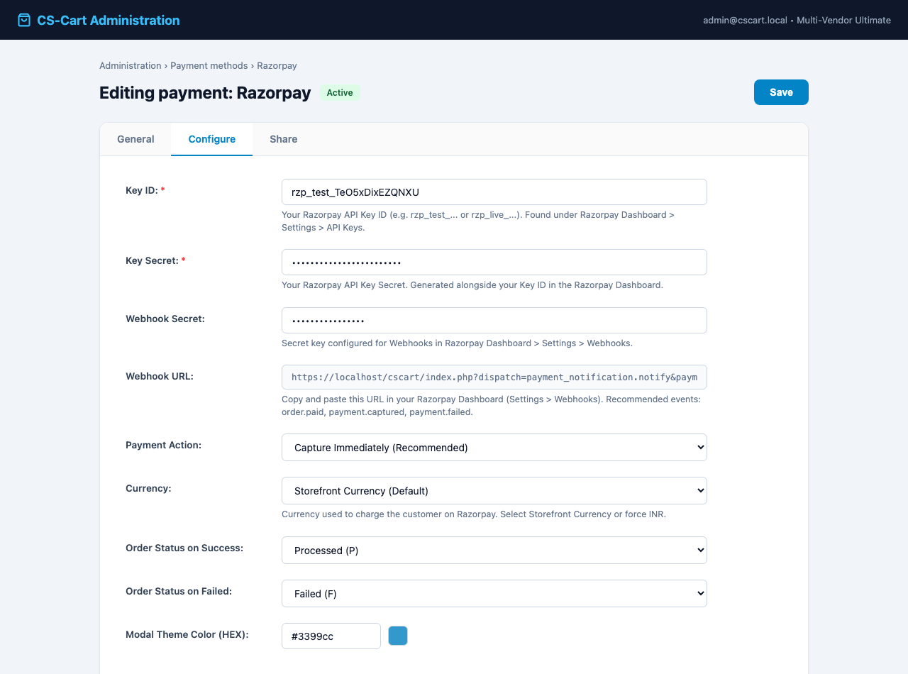
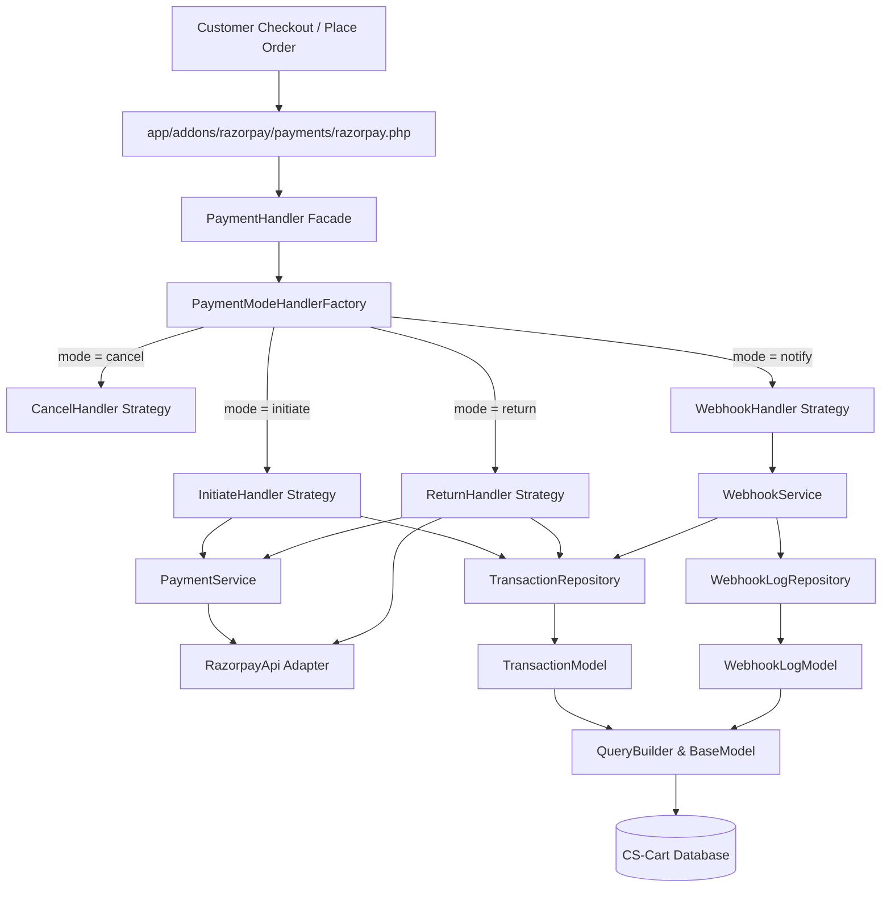
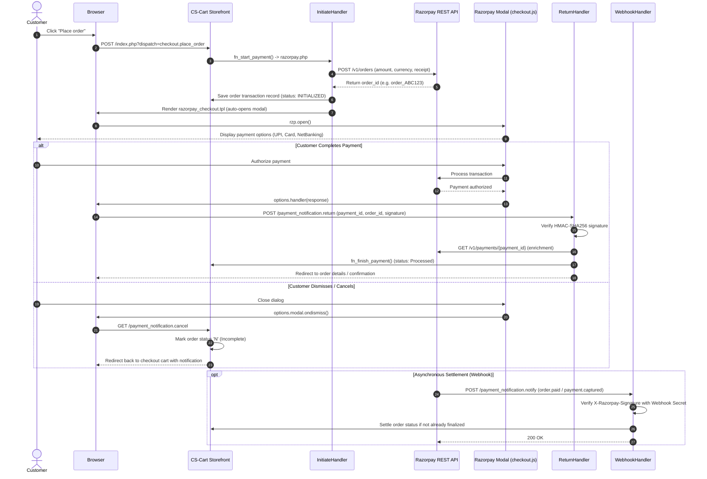

# Razorpay Payment Gateway for CS-Cart & CS-Cart Multi-Vendor

[](https://www.cs-cart.com)
[](https://php.net)
[](#license)
[](#architecture--design-patterns)

A production-grade, native **Razorpay Payment Gateway** add-on for **CS-Cart** and **CS-Cart Multi-Vendor** (4.12.x - 4.21.x). Engineered from the ground up adhering to Google/MNC enterprise software engineering standards, strict **SOLID** principles, Gang of Four (**GoF**) design patterns, a fluent SQL Query Builder, standalone idempotent database schemas, and seamless front-end checkout modal integration.

---

## Screenshots

| Razorpay Live Checkout Modal | Presentation & Auto-Launch Card |
| :---: | :---: |
|  |  |

<p align="center">
  <b>Admin Payment Method Configuration (CS-Cart Admin Panel)</b><br>
  
</p>

---

## Table of Contents

- [Screenshots](#screenshots)
- [Key Features](#key-features)
- [Supported Payment Methods](#supported-payment-methods)
- [Architecture & Design Patterns](#architecture--design-patterns)
- [Directory Structure](#directory-structure)
- [Payment Lifecycle Flow](#payment-lifecycle-flow)
- [Database Schema](#database-schema)
- [Configuration Reference](#configuration-reference)
- [Security & Compliance](#security--compliance)
- [Quick Installation](#quick-installation)
- [Troubleshooting & FAQs](#troubleshooting--faqs)
- [License](#license)

---

## Key Features

- **Standard Checkout Modal (checkout.js)**: Embedded popup checkout with merchant-branded styling, zero customer friction, and mobile-first responsiveness.
- **Timing-Safe Signature Verification**: Validates all incoming return callbacks using HMAC-SHA256 with `hash_equals()` to completely eradicate timing side-channel attacks.
- **Asynchronous Webhook Engine**: Captures external server-to-server webhook notifications (`order.paid`, `payment.captured`, `payment.failed`) with idempotency check, signature validation, and database audit logging.
- **Fluent Query Builder & Active Model Layer**: Decoupled Model layer (`BaseModel`, `QueryBuilder`, entity models) that constructs parameterized SQL queries dynamically without raw query injection risks.
- **Zero Core File Overwrites**: Strictly self-contained add-on following CS-Cart Scheme 4.0 XML specification and PSR-4 autoloading (`Tygh\Addons\Razorpay\*`).
- **Clean Schema Management**: Dedicated, clean SQL files (`install.sql` and `uninstall.sql`) with safe `DROP TABLE IF EXISTS` and automatic processor registration.
- **Currency & Subunit Precision**: Automatic conversion between storefront currency and Razorpay subunits (e.g., INR paise, USD cents) with configurable currency fallback.
- **Automatic Fallback UI**: Dedicated checkout presentation page with dual-ring CSS spinner, auto-open script with `data-no-defer="true"`, fallback manual "Pay Now" button, and user cancellation handling.
- **Payment Method Detail Enrichment**: Fetches payment mode details (Card network, UPI VPA, Bank name, Wallet provider) directly from Razorpay REST API and stores them in CS-Cart order payment details.

---

## Supported Payment Methods

Through Razorpay's unified checkout, customers can pay using:

| Payment Method | Channels Supported |
| :--- | :--- |
| **UPI** | Google Pay, PhonePe, Paytm, BHIM, Cred, and Any UPI App (Collect & Intent) |
| **Credit & Debit Cards** | Visa, MasterCard, RuPay, Maestro, American Express, Diners Club |
| **Net Banking** | 50+ Indian banks including HDFC, ICICI, SBI, Axis, Kotak |
| **Wallets** | Paytm, PhonePe, Amazon Pay, Mobikwik, Freecharge, Airtel Money |
| **Pay Later & Cardless EMI** | Simpl, Lazypay, ZestMoney, ICICI PayLater, HDFC FlexiPay |
| **International Cards** | Global multicurrency cards supported by Razorpay |

---

## Architecture & Design Patterns

The add-on is architected according to Low-Level Design (LLD) best practices, eliminating procedural payment script debt in favor of testable, decoupled components:



### Applied GoF Design Patterns

| Pattern | Implementation Classes | Responsibility |
| :--- | :--- | :--- |
| **Strategy Pattern** | `InitiateHandler`<br>`ReturnHandler`<br>`CancelHandler`<br>`WebhookHandler` | Isolates each payment mode into dedicated, single-responsibility strategies implementing `PaymentModeHandlerInterface`. |
| **Factory Pattern** | `PaymentModeHandlerFactory` | Dynamically resolves and instantiates the correct mode strategy; allows registering custom strategies via `registerStrategy()` (Open/Closed Principle). |
| **Facade Pattern** | `PaymentHandler` | High-level orchestrator that resolves request context (`PaymentContext`) and delegates execution to the resolved strategy. |
| **Adapter Pattern** | `RazorpayApi` | Encapsulates external Razorpay REST API communication (cURL, HTTP Basic Auth, JSON parsing, timeout handling) behind `PaymentApiInterface`. |
| **Repository Pattern** | `TransactionRepository`<br>`WebhookLogRepository` | Decouples domain logic from persistence; exposes expressive domain methods (`markAuthorized`, `markCaptured`, `findByRazorpayOrderId`). |
| **Builder Pattern** | `QueryBuilder` | Provides a fluent SQL builder supporting `table()`, `select()`, `where()`, `whereIn()`, `join()`, `groupBy()`, `having()`, and `orderBy()`. |
| **DTO (Value Objects)** | `PaymentContext`<br>`RazorpayOrderResult` | Replaces loose associative arrays with immutable, type-safe data transfer objects. |
| **Observer Pattern** | `PaymentsHookHandler`<br>`OrdersHookHandler` | Listens to CS-Cart application events (`update_payment_post`, `get_payment_processors_post`, `finish_payment`) to maintain data integrity. |

### SOLID Principles Adherence

- **Single Responsibility (SRP)**: Handlers only handle workflow state; repositories only handle persistence; API adapter only handles HTTP transport.
- **Open/Closed (OCP)**: New modes (e.g. `refund`, `partial_capture`) can be introduced by creating a class implementing `PaymentModeHandlerInterface` without touching `PaymentHandler`.
- **Liskov Substitution (LSP)**: All strategy classes strictly satisfy `PaymentModeHandlerInterface`. All repositories implement their respective contracts.
- **Interface Segregation (ISP)**: Interfaces in `src/Contracts/` are granular and purpose-built (`PaymentApiInterface`, `PaymentServiceInterface`, `TransactionRepositoryInterface`, etc.).
- **Dependency Inversion (DIP)**: Components depend on abstractions rather than concrete implementations, wired via Constructor Injection and the `ServiceProvider` (Pimple DI container).

---

## Directory Structure

```
razorpay/
├── app/
│   └── addons/
│       └── razorpay/
│           ├── addon.xml                                                # Scheme 4.0 XML Manifest & Autoloader config
│           ├── database/
│           │   ├── install.sql                                          # Idempotent DB table creation & processor seed
│           │   └── uninstall.sql                                        # Clean table teardown & processor cleanup
│           ├── payments/
│           │   └── razorpay.php                                         # Gateway entry script (PaymentHandler invoker)
│           └── src/
│               ├── Bootstrap.php                                        # Hook registrations & autoloader init
│               ├── ServiceProvider.php                                  # Pimple DI Container (Factory & Service registry)
│               ├── Installer.php                                        # Add-on lifecycle installer (InstallerInterface)
│               ├── Helper.php                                           # Payment helper utilities
│               │
│               ├── Contracts/                                           # Granular Interfaces
│               │   ├── PaymentApiInterface.php                          # Gateway API contract
│               │   ├── PaymentModeHandlerInterface.php                  # Strategy interface for payment modes
│               │   ├── PaymentServiceInterface.php                      # Currency & checkout payload contract
│               │   ├── TransactionRepositoryInterface.php               # Transaction persistence contract
│               │   ├── WebhookLogRepositoryInterface.php                # Webhook audit log contract
│               │   └── WebhookProcessorInterface.php                    # Webhook ingestion contract
│               │
│               ├── DTO/                                                 # Data Transfer Objects
│               │   ├── PaymentContext.php                               # Immutable execution context
│               │   └── RazorpayOrderResult.php                          # Order creation result DTO
│               │
│               ├── Handlers/                                            # Mode Strategies & Facade
│               │   ├── PaymentHandler.php                               # Main orchestrator & dispatcher
│               │   ├── PaymentModeHandlerFactory.php                    # Strategy Factory
│               │   └── Modes/
│               │       ├── InitiateHandler.php                          # Checkout initiation & Smarty modal rendering
│               │       ├── ReturnHandler.php                            # Return callback & HMAC-SHA256 verification
│               │       ├── CancelHandler.php                            # User cancellation & cart recovery
│               │       └── WebhookHandler.php                           # Async webhook ingestion
│               │
│               ├── Repositories/                                        # Data Access Layer
│               │   ├── TransactionRepository.php                        # Transaction entity repository
│               │   └── WebhookLogRepository.php                         # Webhook audit log repository
│               │
│               ├── Services/                                            # Domain Services & Adapters
│               │   ├── RazorpayApi.php                                  # Razorpay REST API client
│               │   ├── PaymentService.php                               # Domain calculations, subunits & options
│               │   └── WebhookService.php                               # Webhook processing & order settlement
│               │
│               ├── Model/                                               # Active Record & Query Builder
│               │   ├── BaseModel.php                                    # Query construction & generic CRUD base
│               │   ├── QueryBuilder.php                                 # Fluent Query Builder (JOINs, GROUP BY, HAVING)
│               │   ├── TransactionModel.php                             # ?:razorpay_transactions model
│               │   ├── WebhookLogModel.php                              # ?:razorpay_webhook_logs model
│               │   ├── PaymentProcessorModel.php                        # ?:payment_processors model
│               │   └── PaymentModel.php                                 # ?:payments model
│               │
│               ├── HookHandlers/                                        # Observer Event Listeners
│               │   ├── PaymentsHookHandler.php                          # Payment processor event observer
│               │   └── OrdersHookHandler.php                            # Order placement observer
│               │
│               └── PaymentHandler/
│                   └── PaymentHandler.php                               # Backward-compatibility alias
│
├── design/
│   ├── backend/
│   │   └── templates/
│   │       └── addons/
│   │           └── razorpay/
│   │               └── views/
│   │                   └── payments/
│   │                       └── components/
│   │                           └── cc_processors/
│   │                               └── razorpay.tpl                     # Admin processor configuration form
│   └── themes/
│       └── responsive/
│           └── templates/
│               └── addons/
│                   └── razorpay/
│                       └── views/
│                           └── orders/
│                               └── components/
│                                   └── payments/
│                                       └── razorpay_checkout.tpl        # Front-end checkout popup template
│
└── var/
    ├── langs/
    │   └── en/
    │       └── addons/
    │           └── razorpay.po                                          # English PO language definitions
    └── themes_repository/
        └── responsive/
            └── templates/
                └── addons/
                    └── razorpay/
                        └── views/
                            └── orders/
                                └── components/
                                    └── payments/
                                        └── razorpay_checkout.tpl        # Add-on installer theme template package
```

---

## Payment Lifecycle Flow



---

## Database Schema

The add-on automatically deploys two dedicated audit tables via `database/install.sql`:

### 1. `?:razorpay_transactions`
Stores granular payment transaction metadata and payment state transitions:

| Field | Type | Description |
| :--- | :--- | :--- |
| `transaction_id` | `INT UNSIGNED AUTO_INCREMENT PRIMARY KEY` | Internal surrogate primary key. |
| `order_id` | `MEDIUMINT UNSIGNED NOT NULL INDEX` | Foreign key referencing CS-Cart `?:orders.order_id`. |
| `razorpay_order_id` | `VARCHAR(64) DEFAULT NULL INDEX` | Razorpay Order ID (`order_...`). |
| `razorpay_payment_id` | `VARCHAR(64) DEFAULT NULL INDEX` | Razorpay Payment ID (`pay_...`). |
| `razorpay_signature` | `VARCHAR(255) DEFAULT NULL` | Cryptographic HMAC-SHA256 signature string. |
| `status` | `VARCHAR(32) NOT NULL DEFAULT 'INITIALIZED'` | Transaction status (`INITIALIZED`, `AUTHORIZED`, `CAPTURED`, `FAILED`, `CANCELLED`). |
| `amount` | `DECIMAL(12,2) NOT NULL DEFAULT 0.00` | Transaction total amount in storefront currency. |
| `currency` | `VARCHAR(10) NOT NULL DEFAULT 'INR'` | ISO 4217 Currency Code. |
| `error_code` | `VARCHAR(64) DEFAULT NULL` | Error code if transaction failed. |
| `error_description` | `TEXT DEFAULT NULL` | Error description returned from Razorpay. |
| `created_at` | `INT UNSIGNED NOT NULL` | UNIX timestamp of creation. |
| `updated_at` | `INT UNSIGNED NOT NULL` | UNIX timestamp of last status update. |

### 2. `?:razorpay_webhook_logs`
Audit log preventing replay attacks and tracking webhook notifications:

| Field | Type | Description |
| :--- | :--- | :--- |
| `log_id` | `INT UNSIGNED AUTO_INCREMENT PRIMARY KEY` | Internal audit log key. |
| `event_id` | `VARCHAR(64) DEFAULT NULL INDEX` | Razorpay unique event ID for deduplication. |
| `event` | `VARCHAR(64) NOT NULL INDEX` | Webhook event name (`order.paid`, `payment.captured`, etc.). |
| `order_id` | `MEDIUMINT UNSIGNED DEFAULT NULL INDEX` | Resolved CS-Cart Order ID. |
| `razorpay_payment_id` | `VARCHAR(64) DEFAULT NULL` | Associated payment ID. |
| `payload` | `MEDIUMTEXT DEFAULT NULL` | Full raw JSON webhook payload. |
| `status` | `VARCHAR(32) NOT NULL DEFAULT 'PROCESSED'` | Ingestion status (`PROCESSED`, `FAILED`, `IGNORED`). |
| `created_at` | `INT UNSIGNED NOT NULL` | UNIX timestamp of receipt. |

---

## Configuration Reference

Navigate to **Administration > Administration > Payment methods**, click **Add payment method**, and select **Razorpay** as processor. In the **Configure** tab, configure:

| Setting | Parameter Key | Required | Description |
| :--- | :--- | :---: | :--- |
| **Key ID** | `key_id` | **Yes** | Razorpay Key ID (`rzp_test_...` or `rzp_live_...`). Available in Razorpay Dashboard > Settings > API Keys. |
| **Key Secret** | `key_secret` | **Yes** | Razorpay Key Secret generated alongside Key ID. |
| **Webhook Secret** | `webhook_secret` | Recommended | Secret passphrase configured in Razorpay Dashboard > Settings > Webhooks. |
| **Webhook URL** | *Display Only* | - | Automatically generated URL to enter into Razorpay Webhook settings. |
| **Payment Action** | `payment_action` | **Yes** | `capture` (Capture Immediately) or `authorize` (Authorize Only, manual capture later). |
| **Currency** | `currency` | **Yes** | Select `storefront` (uses customer's current secondary currency) or force `INR`. |
| **Order Status on Success** | `order_status_success`| **Yes** | Order status assigned on successful verification (Default: `P` - Processed). |
| **Order Status on Failure** | `order_status_failed` | **Yes** | Order status assigned on failed verification (Default: `F` - Failed). |
| **Merchant Display Name** | `merchant_name` | No | Custom store name displayed on Razorpay modal (Defaults to CS-Cart company name). |
| **Modal Theme Color** | `theme_color` | No | Hex color code (e.g. `#3399cc`) matching your storefront branding. |

---

## Security & Compliance

- **PCI-DSS Level 1 Compliant**: Cardholder data is never captured, transmitted, or stored on your CS-Cart server. Card data is submitted directly to Razorpay's PCI-certified infrastructure through an isolated iframe modal.
- **Timing-Safe Cryptography**: Signature verification uses PHP's constant-time `hash_equals()` to prevent side-channel timing attacks.
- **Strict Webhook Authentication**: Webhook requests verify the `X-Razorpay-Signature` header computed over the raw request payload with your Webhook Secret.
- **CSRF & Injection Defense**: Parameterized SQL queries using CS-Cart database placeholders (`?s`, `?i`, `?d`, `?a`) throughout `BaseModel` and `QueryBuilder`.
- **Idempotency Protection**: Webhook deduplication using `event_id` ensures multiple deliveries of the same webhook cannot cause double settlement or repeated state transitions.

---

## Quick Installation

For comprehensive step-by-step instructions, see [INSTALL.md](INSTALL.md).

```bash
# 1. Copy add-on files into CS-Cart root directory
cp -R app/addons/razorpay <CS_CART_ROOT>/app/addons/
cp -R design/backend/templates/addons/razorpay <CS_CART_ROOT>/design/backend/templates/addons/
cp -R design/themes/responsive/templates/addons/razorpay <CS_CART_ROOT>/design/themes/responsive/templates/addons/
cp -R var/themes_repository/responsive/templates/addons/razorpay <CS_CART_ROOT>/var/themes_repository/responsive/templates/addons/
cp var/langs/en/addons/razorpay.po <CS_CART_ROOT>/var/langs/en/addons/

# 2. Clear CS-Cart cache
php <CS_CART_ROOT>/admin.php --dispatch=tools.clear_cache
```

Then in CS-Cart Admin:
1. Go to **Add-ons > Manage add-ons**.
2. Find **Razorpay Payments** and click **Install**.
3. Go to **Administration > Payment methods**, add a new payment method, choose **Razorpay**, and enter your API keys.

---

## Troubleshooting & FAQs

### 1. `Smarty\Exception: Unable to load template '...razorpay_checkout.tpl'`
Ensure that `razorpay_checkout.tpl` exists in your active theme directory (`design/themes/<your_theme>/templates/addons/razorpay/views/orders/components/payments/razorpay_checkout.tpl`) and clear CS-Cart cache via **Administration > Storage > Clear cache**.

### 2. Signature verification failed
- Check that the **Key Secret** in CS-Cart matches the exact Key Secret corresponding to the active **Key ID** in your Razorpay Dashboard.
- Ensure Test keys (`rzp_test_...`) and Live keys (`rzp_live_...`) are not mixed.

### 3. Payment window didn't open automatically
Browsers with aggressive popup blockers might delay automatic execution. The add-on provides a fallback **"Pay Now"** button on the checkout screen allowing customers to open the payment modal with a single click.

### 4. Webhooks showing error in Razorpay Dashboard
- Ensure your storefront is accessible over public HTTPS (Razorpay cannot reach local `localhost` without an ngrok/Cloudflare tunnel).
- Confirm the **Webhook Secret** configured in CS-Cart exactly matches the secret entered in Razorpay Dashboard > Settings > Webhooks.

---

## License

This add-on is distributed under commercial proprietary licensing for CS-Cart and CS-Cart Multi-Vendor platforms. All rights reserved.
